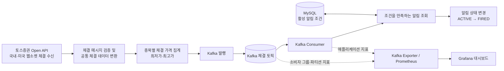

# defomo

토스증권 Open API로 실시간 국내·미국 주식 체결 데이터를 수집하고, 사용자가 등록한 목표 가격에 도달했는지 판별하는 주가 알림 서비스입니다.

현재는 체결 데이터 수집과 Kafka 처리, DB에 저장된 알림 조건 판별까지 구현되어 있습니다. 목표 가격에 도달한 알림은 `FIRED` 상태로 바뀌며, 사용자에게 실제 알림을 전달하는 기능은 아직 구현 범위에 포함되지 않습니다.

기술적인 문제에 대한 해결 방법은 [Wiki](https://github.com/f-lab-edu/defomo/wiki)에서 확인할 수 있습니다.

## 프로젝트의 전체적인 구조



- 국내와 미국 시장은 각각 별도의 웹소켓 연결로 체결 데이터를 수신합니다.
- 수신한 체결을 종목별로 짧은 시간 또는 정해진 건수 단위로 모아 최저가와 최고가를 계산한 뒤 Kafka에 발행합니다.
- Kafka Consumer는 체결 이벤트의 종목과 가격 범위에 해당하는 활성 알림 조건을 DB에서 조회하고, 조건을 충족한 알림을 `FIRED`로 변경합니다.
- Kafka UI, Prometheus, Grafana를 사용해 토픽과 처리 지표를 확인할 수 있습니다.

## 프로젝트의 주요 관심사

프로젝트를 구현하며 겪은 트러블슈팅과 설계 의도는 [Wiki](https://github.com/f-lab-edu/defomo/wiki)에 정리했습니다.

### 체결 데이터 집계와 전달

- 모든 체결을 개별 Kafka 메시지로 발행하는 대신, 종목별 체결 가격 범위를 집계해 이벤트 수를 줄입니다.
- 기본 집계 기준은 최대 100ms 또는 500건이며, 먼저 도달한 기준에서 이벤트를 발행합니다.
- 이벤트에는 시장, 종목 코드, 최저가·최고가, 체결 건수, 집계 시작·종료 시각이 포함됩니다.
- Kafka 발행은 라운드로빈 파티셔너를 사용합니다. 같은 종목의 이벤트가 항상 같은 파티션에 배정되는 방식은 아니므로 종목별 파티션 순서는 보장하지 않습니다.

### 알림 조건 조회와 중복 처리 방지

- 체결 이벤트의 종목·시장·가격 범위에 맞는 `ACTIVE` 알림만 DB에서 조회합니다.
- 목표 가격이 이벤트 가격 범위에 포함되는지 확인해 조건 충족 여부를 판별합니다.
- 조건부 상태 변경으로 `ACTIVE` 알림만 `FIRED`로 바꿉니다. 이미 처리된 알림은 다시 상태가 바뀌지 않습니다.
- 알림 조건 조회를 위한 복합 인덱스를 사용합니다.

### 메시지 처리 오류

- Kafka Consumer 처리 실패 시 지수형 간격으로 재시도하며, JSON 변환 오류는 재시도 대상에서 제외합니다.
- 재시도 한도를 넘긴 메시지를 별도 토픽으로 보관하는 DLQ는 아직 구성하지 않았습니다.

## 실행 방법

### 사전 준비

- JDK 21 이상
- Docker Desktop 또는 Docker Engine과 Docker Compose
- 체결 데이터 수신이 필요하면 토스증권 Open API 인증 정보와 허용된 실행 환경 IP

저장소 루트에서 `.env.example`을 복사하고 필요한 값을 설정합니다. `.env`는 Git에서 제외되며, Spring Boot가 실행할 때 읽습니다. 인증 정보는 `.env.example`이나 Git에 추적되는 파일에 저장하지 마세요.

```bash
cp .env.example .env
# .env에서 인증 정보, 구독 종목, 필요 시 DB 연결 정보를 설정
docker compose up -d
./gradlew bootRun
```

토스증권 인증 정보 두 개가 모두 설정되면 애플리케이션 시작 시 웹소켓 연결과 종목 구독을 시도합니다. 구독 종목은 시장별 환경 변수에 쉼표로 구분해 설정하며, 한 시장에서 최대 100개까지 지정할 수 있습니다. 연결 종료 후 자동 재연결은 아직 구현되지 않았습니다.

체결 수신을 확인할 때는 애플리케이션 로그에서 연결·구독 결과와 종목별 첫 체결 요약을 확인할 수 있습니다. 이후 체결 요약은 로그량을 줄이기 위해 DEBUG 레벨로 기록됩니다. 실제 거래가 없는 종목은 구독이 성공해도 체결 로그가 나타나지 않을 수 있습니다.

## 모니터링

Docker Compose로 실행한 로컬 모니터링 도구는 다음 주소에서 확인할 수 있습니다.

| 도구 | 주소 | 용도 |
|---|---|---|
| Kafka UI | [http://localhost:8081](http://localhost:8081) | Kafka 토픽, 레코드, Consumer 그룹 확인 |
| Prometheus | [http://localhost:9090](http://localhost:9090) | 애플리케이션 및 Kafka 지표 조회 |
| Grafana | [http://localhost:3000](http://localhost:3000) | 체결 수신량, 배치 발행량, 알림 판정 시간, Consumer Lag 등 대시보드 확인 |

## 테스트

Gradle Wrapper로 테스트를 실행합니다.

```bash
./gradlew test
```

현재 집계기의 체결 입력과 만료 처리가 동시에 실행되는 상황을 다루는 동시성 테스트가 포함되어 있습니다.

## 사용 기술 및 환경

- Java 21, Spring Boot 3.5
- Spring Kafka, Apache Kafka
- MySQL 8, Spring Data JPA, Flyway
- Toss Securities Open API WebSocket
- Docker Compose, Kafbat Kafka UI
- Spring Boot Actuator, Micrometer Prometheus, Prometheus, Grafana
- Gradle Wrapper
